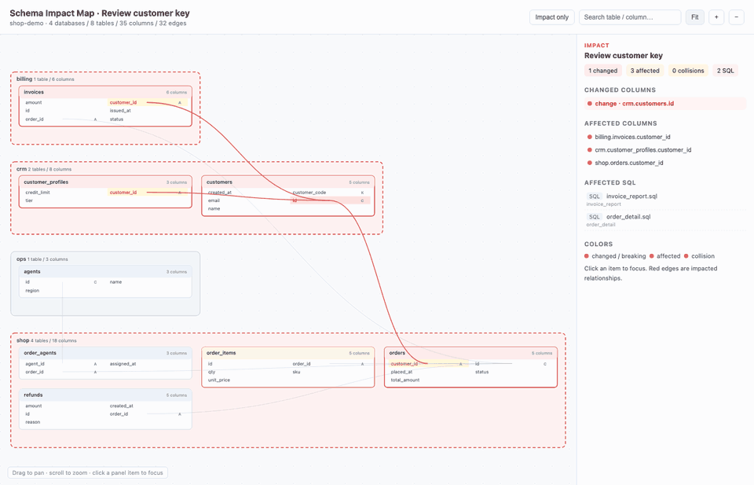

# Schema Impact Map

**An impact-aware map of relational data assets.**

*Readable context before an agent writes; evidence before the change lands.*

[](https://github.com/sunzhongding/schema-impact-map/actions/workflows/ci.yml)
[](https://github.com/sunzhongding/schema-impact-map/actions/workflows/pages.yml)

> Repository: [`sunzhongding/schema-impact-map`](https://github.com/sunzhongding/schema-impact-map)
> · CLI: `schema-impact-map` · Python: `schema_impact_map`

Schema Impact Map turns a relational schema into a single interactive map of databases,
tables and columns, connects the columns that reference each other, and highlights what a
proposed change will break — in red, orange and yellow.



Most schema tools draw an ERD. Schema Impact Map answers a different question:

> *If I change this column, which fields, relationships and SQL statements are affected?*

It is designed for the workflow where an AI agent proposes a change, a human reviews it,
and the change lands in a migration or a mapper. The map and the impact report are static
HTML — no server, no credentials in the browser, no database connection required to view.

## Why

AI can propose a schema change in seconds; reviewing one still costs a human an afternoon.
Most production schemas also have no complete set of foreign keys — relationships live in
SQL, naming and data. The work splits at two checkpoints:

- **Before an agent writes** — the ledger makes the relationships readable: databases,
  tables, columns, keys, SQL joins and human decisions as text, not a live database.
- **Before the change lands** — the impact map makes the blast radius reviewable: changed
  columns, affected columns, naming collisions and affected SQL, each with its evidence.

It keeps the evidence:

| Evidence | Meaning | Typical confidence |
|---|---|---|
| `fk` | declared foreign key | 1.0 |
| `sql_join` | a join that really exists in code | 0.9 |
| `value_overlap` | values of a child column overlap a parent key | 0.9–0.95 |
| `same_entity` | a human decided two columns are the same entity | 1.0 |

Cross-database edges are first-class: the demo has `shop`, `crm`, `billing` and `ops`
databases connected by declared relationships and SQL joins.

## Quick start

```bash
git clone https://github.com/sunzhongding/schema-impact-map.git
cd schema-impact-map

python -m venv .venv
source .venv/bin/activate
pip install -e ".[dev]"

schema-impact-map demo
open site/index.html
```

No database is needed. The demo is generated from the synthetic files in
[`examples/shop`](examples/shop).

### From a SQLite file

Already have a `.db`? Turn it into a ledger without a server or credentials — the file is
opened read-only and only schema metadata is read:

```bash
schema-impact-map introspect --sqlite app.db --out ledger --write-config
schema-impact-map check --data ledger
schema-impact-map demo  --data ledger --out site
```

`--write-config` adds `schema-impact-map.yaml` (`dialect: sqlite`), `entities.yaml`,
`rules.yaml` and an empty `sql/` next to `schema.json`; existing files are never overwritten.
Views, virtual tables and composite foreign keys are reported as warnings and skipped.

| Page | What it shows |
|---|---|
| `site/index.html` | interactive map: drag, zoom, search, fit |
| `site/impact.html` | impact of changing `crm.customers.id`: 3 affected columns, 2 SQL statements |
| `site/impact-refund.html` | adding `shop.refunds.status`: collisions with existing status columns |


## How it works

```
examples/shop/
├── schema.json       physical schema + declared relations (synthetic)
├── entities.yaml     human decisions: customer / order / agent
├── rules.yaml        what is not a relationship
├── sql/*.sql         joins that really exist in code
└── plans/*.yaml      proposed changes (what-if input)

        │
        ▼

schema-impact-map build ──► graph.json ──┬──► schema-impact-map map    ──► interactive HTML
                                         └──► schema-impact-map impact ──► highlighted HTML
```

### 1. Schema + relations

`schema.json` lists databases, tables, columns, keys and declared relations. Relations can
cross databases; the demo does exactly that.

### 2. SQL joins

`sql.py` parses every `.sql` file with [sqlglot](https://github.com/tobymao/sqlglot),
resolves table aliases, and extracts column-level join predicates. A declared FK and a SQL
join for the same pair are merged into one edge with confidence `1.0`.

### 3. Entities

`entities.yaml` is the human layer:

```yaml
entities:
  customer:
    canonical: crm.customers.id
    aliases:
      - shop.orders.customer_id
      - billing.invoices.customer_id
```

The map marks `C` (canonical), `A` (alias) and `K` (business key). The check fails if a
`*_id` column has no relation and no entity declaration.

### 4. Impact

A plan is a small YAML file:

```yaml
name: Review customer key
changes:
  analyze_columns:
    - crm.customers.id
```

```bash
schema-impact-map impact --plan examples/shop/plans/customer-key.yaml --out site/impact.html
```

Colors:

- **red**: changed column, breaking impact, impacted relationship, affected table/database
- **orange**: new column, affected column
- **yellow**: naming/semantic collision with an existing column
- **red dashed**: relationship proposed by the plan

The right panel lists changed columns, affected columns, collisions, affected SQL and
tables. Click any item to focus it. “Impact only” fades everything unrelated.

## Input layout

A data directory is just text:

```yaml
# schema-impact-map.yaml
name: shop-demo
dialect: mysql
default_database: shop
schema: schema.json
entities: entities.yaml
rules: rules.yaml
sql: sql
```

- `schema.json`: databases → tables → columns, plus declared `relations`
- `entities.yaml`: canonical / aliases / business keys (human decisions)
- `rules.yaml`: `*_id` patterns and columns that are not relationships
- `sql/`: `.sql` files whose joins are parsed into field-level edges
- `plans/`: YAML deltas for `schema-impact-map impact`

`schema.json` can be written by hand or generated from a SQLite file with `introspect`;
`dialect` accepts anything [sqlglot](https://github.com/tobymao/sqlglot) understands
(`mysql`, `postgres`, `sqlite`, `bigquery`, ...).

## Commands

```bash
schema-impact-map build  --data examples/shop --out dist
schema-impact-map map    --data examples/shop --out site/map.html
schema-impact-map impact --data examples/shop --plan examples/shop/plans/customer-key.yaml \
                          --out site/impact.html
schema-impact-map impact --plan plan.yaml --format md       # comment-sized report
schema-impact-map impact --plan plan.yaml --fail-on breaking  # CI gate
schema-impact-map plan   --diff origin/main...HEAD --data ledger --out plan.yaml
schema-impact-map context --data ledger --for "crm.customers,shop.orders" --budget 1500
schema-impact-map check  --data examples/shop
schema-impact-map demo   --data examples/shop --out site
schema-impact-map introspect --sqlite app.db --out ledger   # schema.json from a SQLite file
schema-impact-map mcp    # serve the MCP tools over stdio
```

`check` validates:

- every declared relation points to a real column
- every entity member exists
- every `*_id` column is explained by a relation or an entity (or ignored with a reason)

## Use it from your agent

The same graph is available inside AI coding clients: a stdio MCP server, plus a plugin
package that Claude Code and ZCode load directly and a `SKILL.md` that Codex and WorkBuddy
pick up.

```bash
uv tool install "schema-impact-map[mcp]"   # or: pipx install "schema-impact-map[mcp]"
schema-impact-map mcp                      # MCP tools: check, impact, render, build_graph, introspect_sqlite
```

| Client | What to install | Guide |
|---|---|---|
| **Claude Code** | `/plugin marketplace add sunzhongding/schema-impact-map` → `/plugin install schema-impact-map@schema-impact-map` | [docs/integrations/claude-code.md](docs/integrations/claude-code.md) |
| **Codex** | MCP entry in `~/.codex/config.toml` + skill in `~/.codex/skills/` | [docs/integrations/codex.md](docs/integrations/codex.md) |
| **ZCode** | add this repository as a plugin market | [docs/integrations/zcode.md](docs/integrations/zcode.md) |
| **WorkBuddy** | `~/.workbuddy/mcp.json` + skill upload | [docs/integrations/workbuddy.md](docs/integrations/workbuddy.md) |

All four tools are local and read-only: they read the ledger, parse SQL text, and write at
most the HTML page you asked for. No database connection, no credentials, no network.

## Review schema changes in a pull request

`impact --format md` prints a comment-sized report; `--format json` prints the same result
for scripts; `--fail-on` turns it into a gate that fails the job.

```bash
schema-impact-map impact --plan plan.yaml --format md
schema-impact-map impact --plan plan.yaml --fail-on breaking
```

The repository ships a composite action that renders the report, keeps exactly one pull
request comment up to date, and can upload the HTML map:

```yaml
# .github/workflows/schema-impact.yml
name: schema impact
on: pull_request
permissions:
  contents: read
  pull-requests: write
jobs:
  impact:
    runs-on: ubuntu-latest
    steps:
      - uses: actions/checkout@v4
      - uses: sunzhongding/schema-impact-map@v1
        with:
          data: ledger
          plan: .schema-impact/plan.yaml
          fail-on: breaking
```

See [docs/integrations/github-action.md](docs/integrations/github-action.md) for inputs,
outputs, and how the comment is kept up to date.

## Derive the plan from the migration

Writing the plan YAML by hand is the step people skip. Let the migration write it:

```bash
schema-impact-map plan --diff origin/main...HEAD --data ledger --out plan.yaml
```

`plan` reads the added lines of the diff (or a file with `--sql migration.sql`), understands
`ALTER TABLE ... ADD/DROP/RENAME COLUMN` and the Alembic `op.add_column` / `op.drop_column` /
`op.alter_column` calls, and qualifies bare table names through the ledger. Anything it
cannot model (CREATE/DROP TABLE, indexes, triggers) becomes a warning, never a guess.

## Give an agent the slice it needs

An agent cannot read 4,000 columns. Give it the ones that matter:

```bash
schema-impact-map context --data ledger --for "crm.customers,shop.orders" --budget 1500
```

It prints the seed tables, their key columns, the relationships that reach them and the SQL
that touches them, in priority order, and stops at the token budget instead of cutting a line.
The MCP server exposes the same slice as the `context` tool, and the `SKILL.md` tells agents
to call it before reading the ledger.

## What this is / is not

This is:

- a **static HTML map** you can open locally or publish on GitHub Pages
- an **impact view** driven by the same graph as the map
- a **small, auditable model** (`schema.json` + `entities.yaml` + `rules.yaml`)

This is not (yet):

- a full data catalog or governance platform
- a live database scanner — it reads a ledger; SQLite files can be introspected read-only, MySQL/PostgreSQL are on the roadmap
- a runtime lineage tool — it reasons over schema + SQL text, not query logs
- a complete SQL parser — complex/dynamic SQL should be added as test fixtures

## Multi-database roadmap

The demo already models four databases and cross-database relations. The next steps:

| Version | Scope |
|---|---|
| 0.1 | demo schema JSON, SQL files, entity map, impact map (released) |
| 0.2 | MCP server + agent plugin for Claude Code, Codex, ZCode and WorkBuddy (released) |
| 0.3 | SQLite introspection (`introspect --sqlite`) and `dialect: sqlite` (this release) |
| 0.4 | MySQL + PostgreSQL introspection (read-only `information_schema`) |
| 0.5 | value-overlap probing; a GitHub Action that posts an impact map on PRs |

The qualified name is designed to grow from `database.table.column` to
`instance.database.schema.table.column`; see [docs/design.md](docs/design.md).

## Security

- The demo contains **only synthetic data**.
- The tool never stores database credentials.
- The generated HTML is self-contained (no CDN, no telemetry).
- The map only contains schema names and declared relations, not row values.
- SQLite introspection opens the file read-only and reads schema metadata only, no rows.

## Contributing

See [CONTRIBUTING.md](CONTRIBUTING.md). Good first issues: add a MySQL connector, add a
MyBatis XML extractor, add a PostgreSQL test fixture, improve the map layout.

## 中文简介

在 AI 动手前，让数据关系可读；在变更落地前，让影响可查。

Schema Impact Map 把关系型数据库的库、表、字段画成一张可拖拽/缩放的地图，并把字段之间的关系连起来。
给一个“方案变更” YAML，它会把受影响的字段、关系边和 SQL 用红/橙/黄标出来。

```bash
schema-impact-map demo
open site/index.html      # 交互地图
open site/impact.html     # 影响高亮
```

当前 v0.1 用 `examples/shop` 的合成数据，不连接任何真实数据库。后续会加
MySQL/PostgreSQL 连接器和跨库值域探查。

## License

Apache-2.0. See [LICENSE](LICENSE).
