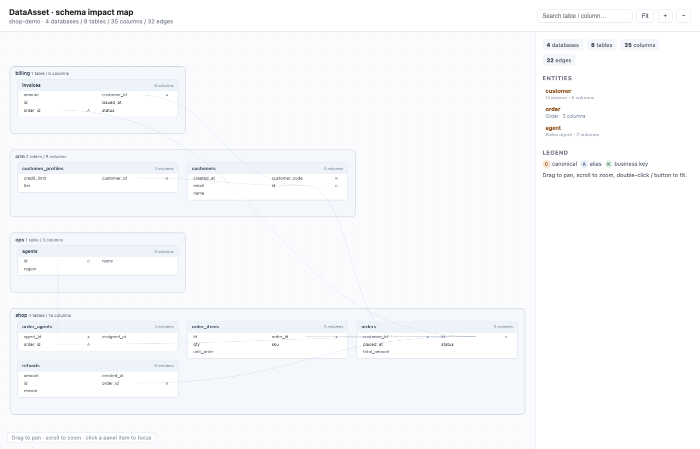
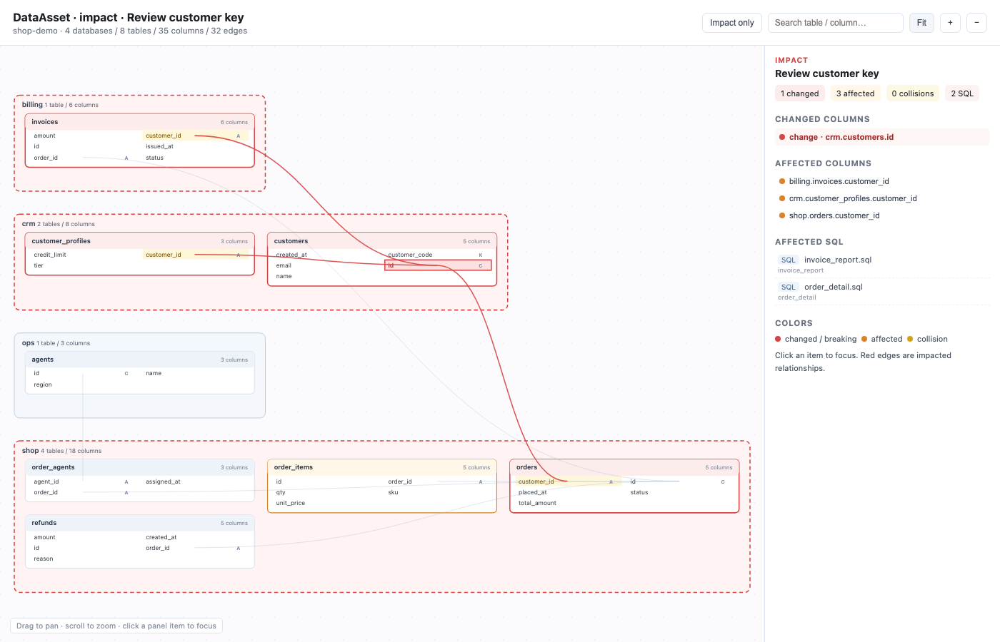

# DataAsset

**An impact-aware map of relational data assets.**

[](https://github.com/sunzhongding/schema-impact-map/actions/workflows/ci.yml)
[](https://github.com/sunzhongding/schema-impact-map/actions/workflows/pages.yml)

> Repository: [`sunzhongding/schema-impact-map`](https://github.com/sunzhongding/schema-impact-map)
> · Python package / CLI: `dataasset`

DataAsset turns a relational schema into a single interactive map of databases, tables and
columns, connects the columns that reference each other, and highlights what a proposed
change will break — in red, orange and yellow.



Most schema tools draw an ERD. DataAsset answers a different question:

> *If I change this column, which fields, relationships and SQL statements are affected?*

It is designed for the workflow where an AI agent proposes a change, a human reviews it,
and the change lands in a migration or a mapper. The map and the impact report are static
HTML — no server, no credentials in the browser, no database connection required to view.

## Why

- Relational schemas are assets, but their relationships rarely live in one place.
- Many production databases have no foreign keys; relationships live in SQL, naming and data.
- AI makes schema changes cheap to propose and expensive to review. Review needs evidence.

DataAsset keeps the evidence:

| Evidence | Meaning | Typical confidence |
|---|---|---|
| `fk` | declared foreign key | 1.0 |
| `sql_join` | a join that really exists in code | 0.9 |
| `value_overlap` | values of a child column overlap a parent key | 0.9–0.95 |
| `same_entity` | a human decided two columns are the same entity | 1.0 |

Cross-database edges are first-class: the demo has `shop`, `crm`, `billing` and `ops`
databases connected by declared relationships and SQL joins.

## Quick start

```bash
git clone https://github.com/sunzhongding/schema-impact-map.git
cd schema-impact-map

python -m venv .venv
source .venv/bin/activate
pip install -e ".[dev]"

dataasset demo
open site/index.html
```

No database is needed. The demo is generated from the synthetic files in
[`examples/shop`](examples/shop).

| Page | What it shows |
|---|---|
| `site/index.html` | interactive map: drag, zoom, search, fit |
| `site/impact.html` | impact of changing `crm.customers.id`: 3 affected columns, 2 SQL statements |
| `site/impact-refund.html` | adding `shop.refunds.status`: collisions with existing status columns |



## How it works

```
examples/shop/
├── schema.json       physical schema + declared relations (synthetic)
├── entities.yaml     human decisions: customer / order / agent
├── rules.yaml        what is not a relationship
├── sql/*.sql         joins that really exist in code
└── plans/*.yaml      proposed changes (what-if input)

        │
        ▼

dataasset build  ───►  graph.json  ───►  dataasset map  ───►  interactive HTML
                                      └─ dataasset impact ───►  highlighted HTML
```

### 1. Schema + relations

`schema.json` lists databases, tables, columns, keys and declared relations. Relations can
cross databases; the demo does exactly that.

### 2. SQL joins

`sql.py` parses every `.sql` file with [sqlglot](https://github.com/tobymao/sqlglot),
resolves table aliases, and extracts column-level join predicates. A declared FK and a SQL
join for the same pair are merged into one edge with confidence `1.0`.

### 3. Entities

`entities.yaml` is the human layer:

```yaml
entities:
  customer:
    canonical: crm.customers.id
    aliases:
      - shop.orders.customer_id
      - billing.invoices.customer_id
```

The map marks `C` (canonical), `A` (alias) and `K` (business key). The check fails if a
`*_id` column has no relation and no entity declaration.

### 4. Impact

A plan is a small YAML file:

```yaml
name: Review customer key
changes:
  analyze_columns:
    - crm.customers.id
```

```bash
dataasset impact --plan examples/shop/plans/customer-key.yaml --out site/impact.html
```

Colors:

- **red**: changed column, breaking impact, impacted relationship, affected table/database
- **orange**: new column, affected column
- **yellow**: naming/semantic collision with an existing column
- **red dashed**: relationship proposed by the plan

The right panel lists changed columns, affected columns, collisions, affected SQL and
tables. Click any item to focus it. “Impact only” fades everything unrelated.

## Input layout

A data directory is just text:

```yaml
# dataasset.yaml
name: shop-demo
dialect: mysql
default_database: shop
schema: schema.json
entities: entities.yaml
rules: rules.yaml
sql: sql
```

- `schema.json`: databases → tables → columns, plus declared `relations`
- `entities.yaml`: canonical / aliases / business keys (human decisions)
- `rules.yaml`: `*_id` patterns and columns that are not relationships
- `sql/`: `.sql` files whose joins are parsed into field-level edges
- `plans/`: YAML deltas for `dataasset impact`

## Commands

```bash
dataasset build  --data examples/shop --out dist
dataasset map    --data examples/shop --out site/map.html
dataasset impact --data examples/shop --plan examples/shop/plans/customer-key.yaml \
                 --out site/impact.html
dataasset check  --data examples/shop
dataasset demo   --data examples/shop --out site
```

`check` validates:

- every declared relation points to a real column
- every entity member exists
- every `*_id` column is explained by a relation or an entity (or ignored with a reason)

## What this is / is not

This is:

- a **static HTML map** you can open locally or publish on GitHub Pages
- an **impact view** driven by the same graph as the map
- a **small, auditable model** (`schema.json` + `entities.yaml` + `rules.yaml`)

This is not (yet):

- a full data catalog or governance platform
- a live database scanner — v0.1 reads a schema JSON; a MySQL/PostgreSQL connector is on the roadmap
- a runtime lineage tool — it reasons over schema + SQL text, not query logs
- a complete SQL parser — complex/dynamic SQL should be added as test fixtures

## Multi-database roadmap

The demo already models four databases and cross-database relations. The next steps:

| Version | Scope |
|---|---|
| 0.1 | demo schema JSON, SQL files, entity map, impact map (this release) |
| 0.2 | MySQL + PostgreSQL connectors; same-instance cross-schema |
| 0.3 | cross-instance value-overlap probing (sampling to DuckDB/Arrow), not full data pulls |
| 0.4 | runtime evidence (query logs / audit) and a GitHub Action that posts an impact map on PRs |

The qualified name is designed to grow from `database.table.column` to
`instance.database.schema.table.column`; see [docs/design.md](docs/design.md).

## Security

- The demo contains **only synthetic data**.
- The tool never stores database credentials.
- The generated HTML is self-contained (no CDN, no telemetry).
- The map only contains schema names and declared relations, not row values.

## Contributing

See [CONTRIBUTING.md](CONTRIBUTING.md). Good first issues: add a MySQL connector, add a
MyBatis XML extractor, add a PostgreSQL test fixture, improve the map layout.

## 中文简介

DataAsset 把关系型数据库的库、表、字段画成一张可拖拽/缩放的地图，并把字段之间的关系连起来。
给一个“方案变更” YAML，它会把受影响的字段、关系边和 SQL 用红/橙/黄标出来。

```bash
dataasset demo
open site/index.html      # 交互地图
open site/impact.html     # 影响高亮
```

当前 v0.1 用 `examples/shop` 的合成数据，不连接任何真实数据库。后续会加
MySQL/PostgreSQL 连接器和跨库值域探查。

## License

Apache-2.0. See [LICENSE](LICENSE).
